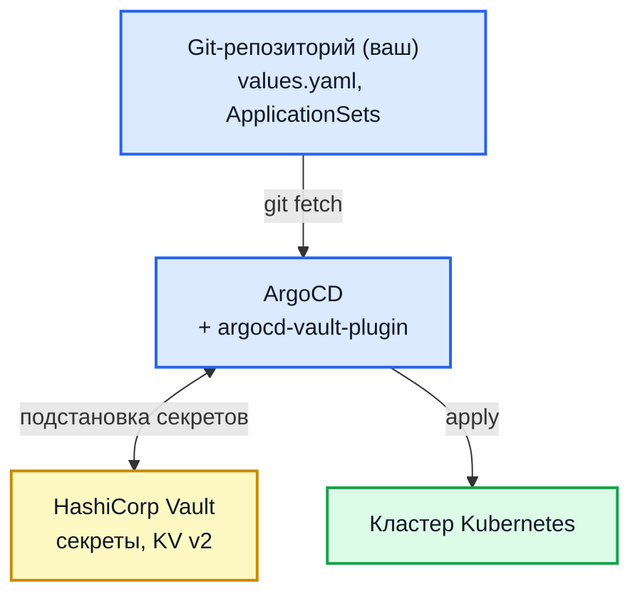

# Развёртывание в Kubernetes

Production-сценарий через Helm-чарты. Поддерживает single-node k3s и multi-node k8s.

> Поставка — Helm-чарт `hub-platform` (umbrella) с готовыми образами Hub. Сборка из исходников не предполагается.

## Что входит

Umbrella-чарт `hub-platform` собирает следующие subcharts:

| Чарт (ключ в значениях)       | Что деплоит                                               |
| ----------------------------- | --------------------------------------------------------- |
| `security-scan-hub` (`hub`)   | Hub backend + worker + frontend + PostgreSQL              |
| `domainscope` (`domainscope`) | DomainScope daemon + PostgreSQL (опц. WireGuard sidecar)  |
| `openvas` (`openvas`)         | Greenbone Community Edition (gvmd/gsad/ospd/pg-gvm/redis) |
| `owasp-zap` (`zap`)           | OWASP ZAP daemon (StatefulSet с PVC)                      |

Все четыре включены по умолчанию; каждый отключается ключом `<ключ>.enabled: false`.

Дополнительно (вне umbrella): `netbox` — NetBox IPAM/DCIM, и `sshub-atlassian-secrets-scanner` — CronJob для сканирования секретов в Jira/Confluence.

!!! warning "Сканерам с PVC нужен `fsGroup`"

    OWASP ZAP работает под uid/gid `1000` и хранит сессии на томе. Без `fsGroup`
    том у обычного CSI приезжает как `root:root`, и под уходит в
    `CrashLoopBackOff` с «The home path is not writable». Чарт задаёт нужный
    `podSecurityContext` сам — не вычищайте его при переопределении значений.
    На k3s (`local-path`, права `0777`) поломка не воспроизводится, поэтому
    проверка на нём такой дефект не ловит. Подробнее:
    [Сканеры](env-scanners.md#owasp-zap).

## Получение чартов

Помимо стандартного `helm repo` или OCI-pull, поставка может приходить tarball'ом со всеми чартами и `values.yaml`:

```bash
tar -xzf hub-platform-charts.tar.gz -C /opt/hub-charts
cd /opt/hub-charts
```

Или через helm OCI registry:

```bash
helm pull oci://<your-registry>/securityhub/hub-platform --untar
cd hub-platform
```

## Сценарий A: всё-в-одном (рекомендуется для пилотов)

Подходит для evaluation и небольших инсталляций. Полный стек на одной VM.

### Предусловия

- Linux VM (Ubuntu 22.04+, Debian 12+, RHEL 9+, Astra Linux 1.7)
- 4 vCPU / 8 GB RAM / 60 GB disk без OpenVAS; 6 / 16 / 100 с OpenVAS (см. [Расчёт ресурсов](sizing.md))
- Root-доступ
- DNS-запись `hub.example.com` → IP вашей VM (для Let's Encrypt и UI)
- Outbound HTTPS к registry с образами

### Установка

Установите k3s (или используйте свой кластер):

```bash
curl -sfL https://get.k3s.io | sh -
sudo mkdir -p ~/.kube
sudo cp /etc/rancher/k3s/k3s.yaml ~/.kube/config
sudo chown $(id -u):$(id -g) ~/.kube/config
```

Установите helm и cert-manager:

```bash
curl -fsSL https://get.helm.sh/helm-v3.13.0-linux-amd64.tar.gz | tar -xz
sudo mv linux-amd64/helm /usr/local/bin/

helm repo add jetstack https://charts.jetstack.io
helm repo update
helm install cert-manager jetstack/cert-manager \
  --namespace cert-manager --create-namespace \
  --set installCRDs=true
```

`ClusterIssuer` для Let's Encrypt вручную создавать не нужно: при
`tls.mode: letsencrypt` umbrella-чарт создаёт `letsencrypt-prod` сам (HTTP-01
через указанный класс ingress). Заранее созданный объект с тем же именем
приведёт к конфликту при установке.

Заготовьте `values.yaml` (override поверх дефолтов `charts/hub-platform/values.yaml`):

```yaml
# values.yaml
global:
  domain: hub.example.com
domain: hub.example.com # повторяет global.domain

ingress:
  className: traefik # или nginx
tls:
  mode: letsencrypt # selfsigned | letsencrypt | existing | disabled
  letsencryptEmail: <ваш-email> # на него регистрируется учётная запись Let's Encrypt

hub:
  # Режим TLS и класс ingress сабчарты от umbrella не наследуют —
  # задайте их и здесь (install.sh делает то же самое).
  ingress:
    className: traefik
  tls:
    mode: letsencrypt

  backend:
    replicas: 2
    backend:
      image:
        tag: "0.33"
      env:
        appEnv: production
        authMode: LOCAL # или SSO
  worker:
    replicas: 2
    worker:
      image:
        tag: "0.33"
  frontend:
    frontend:
      image:
        tag: "0.33"

  pvc:
    postgresData:
      size: 30Gi # ~1 млн находок; расчёт — sizing.md#база-данных-hub
    backendStorage:
      size: 10Gi # SARIF за срок хранения (7 дней) с запасом; тот же размер у тома логов backend
    workerStorage:
      size: 2Gi # логи worker

domainscope:
  enabled: true
  domainscope:
    image:
      tag: "0.34"

openvas:
  enabled: false # включите, если нужен CVE-сканер

zap:
  enabled: false
```

`FRONTEND_URL` и адрес API для интерфейса umbrella выводит из `global.domain`
сам.

Секреты создаёт umbrella-чарт: при первой установке он генерирует случайные
значения и сохраняет их в `hub-hub-secrets`, `hub-domainscope-secrets`,
`hub-openvas-secrets` и `hub-zap-secrets` (аннотация
`helm.sh/resource-policy: keep`; между обновлениями значения не меняются).
Создавать эти объекты заранее не нужно — установка с уже существующими
завершится ошибкой. Токен, с которым DomainScope обращается к Hub, чарт тоже
выпускает сам. Чтобы задать свои значения, передайте блок `secrets:` отдельным
файлом, который не хранится в git (пустое значение — сгенерировать):

```yaml
# secrets.yaml — не коммитить
secrets:
  hubDbPassword: '<strong-random>'
  hubJwtSecret: '<openssl rand -hex 32>'
  hubLocalAdminPassword: '<strong-admin>'
  domainscopeDbPassword: '<strong-random>'
```

Установка:

```bash
helm install hub /opt/hub-charts/hub-platform \
  -n hub --create-namespace \
  --timeout 15m \
  -f values.yaml -f secrets.yaml
```

`--timeout 15m` — запас для post-install Job, который ждёт окончания миграций
backend: пяти минут по умолчанию на медленном старте не хватает.

Hub стартует через 2-5 минут. OpenVAS дополнительно качает CVE-фиды ~10-30 минут после первого старта.

## Сценарий B: GitOps (ArgoCD + Vault)

Для боевого деплоя с git-as-source-of-truth и централизованным хранением секретов.

### Архитектура



ArgoCD читает чарт и values из вашего git, `argocd-vault-plugin` подменяет плейсхолдеры `<path:kv/data/...>` на реальные секреты из Vault, helm накатывает в кластер.

### Минимальный Application для ArgoCD

```yaml
apiVersion: argoproj.io/v1alpha1
kind: Application
metadata:
  name: hub
  namespace: argocd
spec:
  destination:
    namespace: hub
    server: https://kubernetes.default.svc
  project: default
  source:
    repoURL: <your-git-repo-with-values>
    path: hub-platform
    targetRevision: main
    helm:
      valueFiles:
        - values.yaml
  syncPolicy:
    automated: { prune: true, selfHeal: true }
    syncOptions:
      - CreateNamespace=true
```

## Сценарий C: WireGuard egress (изолированный сканинг)

Если сканеры должны обследовать периметр с выделенного egress IP (например, для попадания в allowlist облачных провайдеров), DomainScope, OpenVAS и OWASP ZAP ходят через WireGuard к отдельному WG-серверу: init-контейнер `wg-setup` поднимает туннель в поде каждого сканера. WG-сервер разворачивается отдельно — скриптами из `scripts/wg/` (`1-setup-server.sh`, `2-generate-clients.sh`, `3-register-peers.sh`; порядок описан в `scripts/wg/README.md`).

`2-generate-clients.sh` записывает блок `wireguard:` в `wg-values.yaml`; вместе с флагами, включающими туннель в каждом сабчарте, значения выглядят так:

```yaml
wireguard:
  enabled: true
  serverPublicKey: "<server-pub-key>"
  serverEndpoint: "<wg-vps-ip>:51820"
  peers:
    domainscope:
      privateKey: "<client-priv-key>"
      podIp: "10.200.0.2/32"
    openvas:
      privateKey: "<client-priv-key>"
      podIp: "10.200.0.3/32"
    zap:
      privateKey: "<client-priv-key>"
      podIp: "10.200.0.4/32"

domainscope:
  wireguard:
    enabled: true
openvas:
  wireguard:
    enabled: true
zap:
  wireguard:
    enabled: true
```

## Секреты

Минимальный набор для production:

- Hub DB password
- Hub JWT secret
- Hub local admin password
- DomainScope DB password
- DomainScope Hub API token (в umbrella выпускается автоматически вместе с проектом по умолчанию; при раздельной установке — ключ Service Account Hub, см. [Загрузка отчётов внешних сканеров](integration-sarif.md))
- Keycloak client secret (если SSO)
- LLM API key (если AI-триаж)
- Учётные данные трекера задач — токен Jira, GitHub или Trello (если ведёте
  задачи; задаются в настройках плагина-провайдера, а не переменными)
- NetBox token (если sync)
- OpenVAS admin password (если CVE-scanner)
- ZAP API key (если DAST)

Все секреты — через k8s Secret (ручное создание / sealed-secrets / external-secrets / Vault+AVP).

!!! note "Секреты плагинов живут в базе, а не в k8s Secret"

    Токены каналов уведомлений и провайдеров задач задаются в настройках
    плагина — для установки целиком или отдельно для проекта — и хранятся в
    базе Hub. В переменные окружения они не выносятся.

## Метрики и непривилегированный frontend

С 0.33:

- каждый долгоживущий процесс отдаёт метрики Prometheus на **отдельном порту**
  (`METRICS_PORT`, по умолчанию `9090`). Prometheus скрейпит порт пода
  напрямую; ingress на него маршрутизировать не нужно и не следует —
  аутентификации у порта нет;
- образ `sshub-frontend` запускается от uid/gid `101`. Чарт из этой поставки
  задаёт тот же `podSecurityContext`, поэтому обновление действий не требует.
  Проверьте окружение, только если переопределяли `securityContext`
  (например, `runAsUser: 0`) или монтировали тома с расчётом на root.

## Проверка после установки

```bash
# Статус pods
kubectl -n hub get pods

# Логи backend (миграции должны прокатиться)
kubectl -n hub logs deploy/hub-backend

# Версия (корневой /version через ingress уходит во frontend — используйте путь API)
curl https://hub.example.com/api/v1/version

# Пароль администратора
kubectl -n hub get secret hub-hub-secrets \
  -o jsonpath='{.data.localAdminPassword}' | base64 -d

# Войти в UI
# https://hub.example.com — admin@localhost.local / пароль из команды выше

# Swagger UI (документация API)
# https://hub.example.com/swagger/index.html
```

## Upgrade

Обновление: смените тег в значениях чарта и примените их. Подробнее — [Обновления](upgrades.md#выбор-версии).

```bash
# Обновить чарт (если поставщик прислал новую версию)
tar -xzf hub-platform-charts-new.tar.gz -C /opt/hub-charts-new

# Apply
helm upgrade hub /opt/hub-charts-new/hub-platform -n hub --timeout 15m \
  -f values.yaml -f secrets.yaml

# Поды с изменившимся шаблоном helm пересоздаёт сам; backend и worker —
# стратегией Recreate (старый под останавливается до старта нового).
kubectl -n hub get pods -w
```

Подробнее: [Обновления](upgrades.md).


Состав компонентов и что из них обязательно — [Архитектура](architecture.md).
Значения ресурсов из чартов — [Расчёт ресурсов](sizing.md).


## Что дальше

[Первые шаги после установки](first-steps.md) — проект, продукт, ключ для
системы сборки и первый загруженный отчёт.
