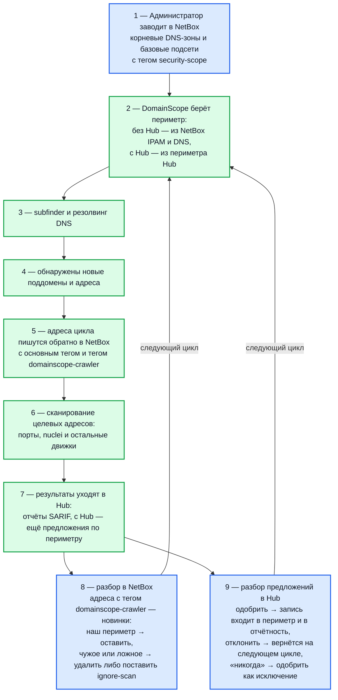

# Синхронизация с NetBox

DomainScope умеет двусторонне работать с NetBox:

- **Импорт целей** (NetBox → DomainScope): IP-адреса и префиксы с указанным тегом становятся targets для сканирования — **только если Hub не подключён**
- **Экспорт адресов цикла** (DomainScope → NetBox): публичные адреса текущего цикла добавляются в NetBox IPAM с тегами
- **Экспорт доменов в NetBox DNS** (опц., DomainScope → NetBox): обнаруженные домены публикуются как DNS-зоны и A/AAAA-записи в NetBox-DNS plugin

## Включение

```ini
DOMAINSCOPE_NETBOX_ENABLED=true
DOMAINSCOPE_NETBOX_API_ENDPOINT=https://netbox.example.com
DOMAINSCOPE_NETBOX_API_TOKEN=<NetBox API token, формат nbt_...>
```

После рестарта в логе появится `netbox import enabled`, а в discovery-цикле — этапы импорта и записи в IPAM.

## Импорт IP-целей (NetBox → DomainScope)

DomainScope тянет IP-адреса и префиксы из NetBox по тегу и добавляет их к targets для port-scan / nuclei / openvas / tlsx.

!!! note "При подключённом Hub цели из NetBox не загружаются"
    Если задан `DOMAINSCOPE_HUB_ENABLED=true`, адреса для сканирования берутся
    из периметра Hub, а импорт целей из NetBox IPAM не выполняется. NetBox
    в этом режиме по-прежнему используется для тегов `ignore-scan`, фильтра
    `DOMAINSCOPE_TRUSTED_IP_TAGS`, обратной записи адресов и NetBox DNS.
    Подключить NetBox как источник периметра Hub можно синхронизацией на
    стороне Hub — см. [Синхронизация периметра с NetBox](integration-netbox.md).

### Конфигурация

```ini
DOMAINSCOPE_NETBOX_ENABLED=true
DOMAINSCOPE_NETBOX_API_ENDPOINT=https://netbox.example.com
DOMAINSCOPE_NETBOX_API_TOKEN=nbt_xxxxxxxxxxxx

# Фильтрация — какие IP тянуть
DOMAINSCOPE_NETBOX_TAG=security-scope             # один основной тег (по умолчанию public-ip)
DOMAINSCOPE_TRUSTED_IP_TAGS=internal,production   # фильтр: сканировать только адреса с этими тегами
```

### Что попадает в targets

- Все `ipam.IPAddress` с указанным тегом в статусе `active`
- Все `ipam.Prefix` с тегом в статусе `active` — разворачиваются до отдельных IP (только IPv4)
  - **Ограничение**: только сети /20 и меньше (макс 4096 IP)
  - Для большего диапазона — создайте дочерние prefix'ы с более узкими масками

### Метаданные

В БД DomainScope для каждого IP сохраняются NetBox-теги, которые потом попадают в SARIF (как `properties.netbox_tags`). В Hub их видно в карточке находка'а.

Полезно: `owner_team`, `environment`, `compliance_zone` теги в NetBox автоматически переедут в Hub.

## Экспорт адресов в NetBox IPAM (DomainScope → NetBox)

В конце каждого discovery-цикла DomainScope записывает в NetBox IPAM
**публичные** адреса этого цикла: адреса из периметра Hub (или импортированные
из NetBox) и адреса доменов, допущенных к сканированию. Запись выполняется
всегда, когда включён NetBox (`DOMAINSCOPE_NETBOX_ENABLED=true`).

```ini
DOMAINSCOPE_NETBOX_TAG=public-ip                     # основной тег (default)
DOMAINSCOPE_NETBOX_CRAWLER_TAG=domainscope-crawler   # дополнительный тег (default)
```

### Что записывается

- адрес, которого среди адресов с тегом `DOMAINSCOPE_NETBOX_TAG` нет, создаётся
  со статусом `active` и **обоими** тегами (плюс тенант, если задан
  `DOMAINSCOPE_NETBOX_TENANT`);
- адрес с этим тегом в другом статусе (например, `deprecated`) переводится в
  `active`;
- адрес в статусе `active` не меняется;
- отсутствующие теги создаются в NetBox автоматически.

Описание, custom fields и прочие поля DomainScope не заполняет. Адреса, которые
перестали встречаться, в `deprecated` не переводятся и не удаляются.

!!! warning "Известное ограничение: обратная запись расширяет цели без ревью"
    Новый адрес получает основной тег `DOMAINSCOPE_NETBOX_TAG` — тот же, по
    которому DomainScope без Hub выбирает цели. Поэтому адрес, однажды
    разрезолвленный, становится постоянной целью уже на следующем цикле, без
    отдельного решения, и остаётся ей, пока его не уберут вручную. Пустой
    `DOMAINSCOPE_NETBOX_CRAWLER_TAG` убирает только дополнительный тег, а не
    саму запись. Существующие адреса ищутся только по основному тегу:
    адрес, уже заведённый в IPAM без этого тега, DomainScope пытается создать
    заново. Исправление отслеживается в [DomainScope#10](https://gitlab.com/hub_infosec/DomainScope/-/work_items/10).

### Как разбирать записанное

Тег `domainscope-crawler` отличает записи DomainScope от заведённых вручную:
фильтр `Tag: domainscope-crawler` в IPAM показывает всё, что добавил сканер.
Чужой или ложный адрес удалите или поставьте ему тег `ignore-scan` — тогда он
не будет сканироваться, даже если снова встретится в цикле.

## Экспорт доменов в NetBox DNS (NetBox-DNS plugin)

Опционально DomainScope **публикует** обнаруженные домены в NetBox через установленный DNS-plugin (направление DomainScope → NetBox, НЕ импорт). Семантика именно экспортная: флаг включает запись discovered-доменов в NetBox как DNS-зон и записей.

```ini
DOMAINSCOPE_NETBOX_DNS_EXPORT_ENABLED=true
# Обязателен при enabled=true: FQDN nameserver для SOA MNAME.
DOMAINSCOPE_NETBOX_DNS_EXPORT_SOA_MNAME=ns1.example.com
# Опц. — имя DNS view (default "default").
DOMAINSCOPE_NETBOX_DNS_EXPORT_VIEW=default
# Опц. — email SOA RNAME (default "hostmaster.<zone>", @ конвертируется в точку).
DOMAINSCOPE_NETBOX_DNS_EXPORT_SOA_RNAME=hostmaster@example.com
```

DomainScope (операция идемпотентна — повторный вызов не плодит дубли):

- Создаёт/находит DNS view и nameserver (из `SOA_MNAME`)
- Для каждой исходной зоны цикла (после фильтров) создаёт/находит Zone
- Для каждого домена из БД, лежащего в одной из этих зон, записывает A-записи по его адресам (DomainScope хранит только IPv4, поэтому AAAA не появляются) — независимо от статуса домена

Тот же view служит источником исходных зон: зоны из него, кроме помеченных
`ignore-scan` и `pending-review`, перечисляются subfinder.

Требования:

- `DOMAINSCOPE_NETBOX_DNS_EXPORT_ENABLED=true` требует включённой основной NetBox-интеграции (`DOMAINSCOPE_NETBOX_ENABLED=true`)
- `DOMAINSCOPE_NETBOX_DNS_EXPORT_SOA_MNAME` **обязателен** при enabled — без него конфиг не пройдёт валидацию
- NetBox-DNS plugin должен быть установлен; токен должен иметь write-permission на DNS-объекты

Если plugin не установлен или экспорт не нужен — оставьте `false` (default).

## NetBox: что админ должен подготовить

### 1. API token

NetBox UI → Profile → API Tokens → Add:

- **Description:** `domainscope-rw`
- **Permissions:** `ipam.view_ipaddress`, `ipam.view_prefix`, `ipam.add_ipaddress`, `ipam.change_ipaddress`, `extras.view_tag`, `extras.add_tag` — запись в IPAM выполняется всегда при включённом NetBox; для NetBox DNS дополнительно права на объекты плагина
- **Allowed IPs:** IP, с которого DomainScope ходит
- **Expires:** опц. +1 год

Token будет в формате `nbt_xxxxxxxxxxxxxx`.

### 2. Теги

Создайте теги:

- `security-scope` (или другое значение `DOMAINSCOPE_NETBOX_TAG`, по умолчанию `public-ip`) — для IP, которые DomainScope должен сканировать
- `domainscope-crawler` — будет проставляться автоматически; DomainScope создаёт его сам, если тега нет
- `ignore-scan`, `pending-review` — теги исключения и ожидания проверки
- `production`, `staging`, `dmz`, и т.п. — для классификации (опц.)

DomainScope не заполняет custom fields и описание записей IPAM — заводить
для него отдельные поля не нужно.

## Порядок управления периметром

Типовая последовательность:



## Hub + DomainScope + NetBox: единая картина

| Слой            | Зачем                                                                     |
| --------------- | ------------------------------------------------------------------------- |
| **NetBox**      | Источник правды по инфраструктуре. Кто чем владеет, какие IP/домены живут |
| **DomainScope** | Активная разведка. Что НА САМОМ ДЕЛЕ доступно снаружи                     |
| **Hub** | Разбор находок и работа по их устранению |

Идеальная схема: NetBox = inventory, DomainScope = recon, Hub = vuln-management. Каждый слой знает только свою часть.

## Производительность

NetBox sync — лёгкая операция (тысячи объектов читаются за секунды). Запускается в составе discovery-цикла (`TIME_LOOP_DISCOVERY=21600`).

Если NetBox в той же сети — sync обычно < 5 секунд. Если NetBox в облаке через интернет — несколько десятков секунд.

## Безопасность

- **Read-only токен не подходит**: при включённом NetBox DomainScope каждый цикл пишет адреса в IPAM, отключить это пустым `DOMAINSCOPE_NETBOX_CRAWLER_TAG` нельзя (см. предупреждение выше). Без прав на запись цикл продолжится, а в логе будет `netbox ipam sync failed`
- **IP allowlist в NetBox**: ограничьте, откуда DomainScope ходит к API

## Проверка интеграции

### 1. Проверка чтения

```bash
# Из контейнера DomainScope
docker compose exec domain-scope curl -fs \
  -H "Authorization: Token $DOMAINSCOPE_NETBOX_API_TOKEN" \
  "$DOMAINSCOPE_NETBOX_API_ENDPOINT/api/ipam/ip-addresses/?tag=security-scope" | jq '.count'
```

Должно вернуть число IP с этим тегом.

### 2. Проверка sync в логах

```bash
docker compose logs domain-scope | grep -i netbox
```

Ожидаем:

```
INFO  netbox import enabled                      {"endpoint": "https://netbox.example.com", "tag": "public-ip", "tenant": ""}
INFO  netbox: prefixes expanded to scan targets  {"prefixes": 3, "expanded_ips": 768, "addr_ips": 142}
INFO  netbox targets loaded                      {"count": 910, "tag": "public-ip"}
INFO  netbox ipam sync: ensuring ips active      {"count": 64, "tags": ["public-ip", "domainscope-crawler"]}
INFO  netbox ipam sync done
INFO  netbox dns export done
INFO  discovery cycle done                       {"scannable_ips": 59, "ignored_ips": 3}
```

Строки `netbox targets loaded` и `prefixes expanded` появляются только без Hub,
`netbox dns export done` — только при включённом экспорте DNS.

### 3. Проверка в NetBox

После цикла зайдите в NetBox UI → IPAM → IP Addresses → filter `Tag: domainscope-crawler` — должны увидеть новые записи.

## Типовые проблемы

| Симптом                      | Что проверить                                                                               |
| ---------------------------- | ------------------------------------------------------------------------------------------- |
| `401 Unauthorized` от NetBox | Токен неверный / истёк / не имеет permission                                                |
| `403 Forbidden`              | Token имеет IP allowlist — добавьте IP DomainScope                                          |
| Sync долго (>30s)            | NetBox медленно отвечает; проверьте load на NetBox-стороне                                  |
| Crawler-теги не появляются   | в логе `netbox ipam sync failed`: у токена нет прав на запись IP или создание тегов          |
| Дубликаты в NetBox или `netbox ipam sync failed` с ошибкой создания IP | адрес уже есть в IPAM, но без тега `DOMAINSCOPE_NETBOX_TAG`: DomainScope ищет существующие адреса только по этому тегу и создаёт адрес заново. Поставьте тег существующей записи |
| Цели из NetBox не сканируются | подключён Hub — в этом режиме цели берутся из периметра Hub |

## Связанные документы

- [Расширение периметра: обнаружение доменов и адресов](domainscope-scope-discovery.md) — как находятся и предлагаются новые домены
- [Интеграция с NetBox](integration-netbox.md) — NetBox sync со стороны Hub
- [Происхождение записей периметра](domainscope-trails.md) — provenance в DomainScope
