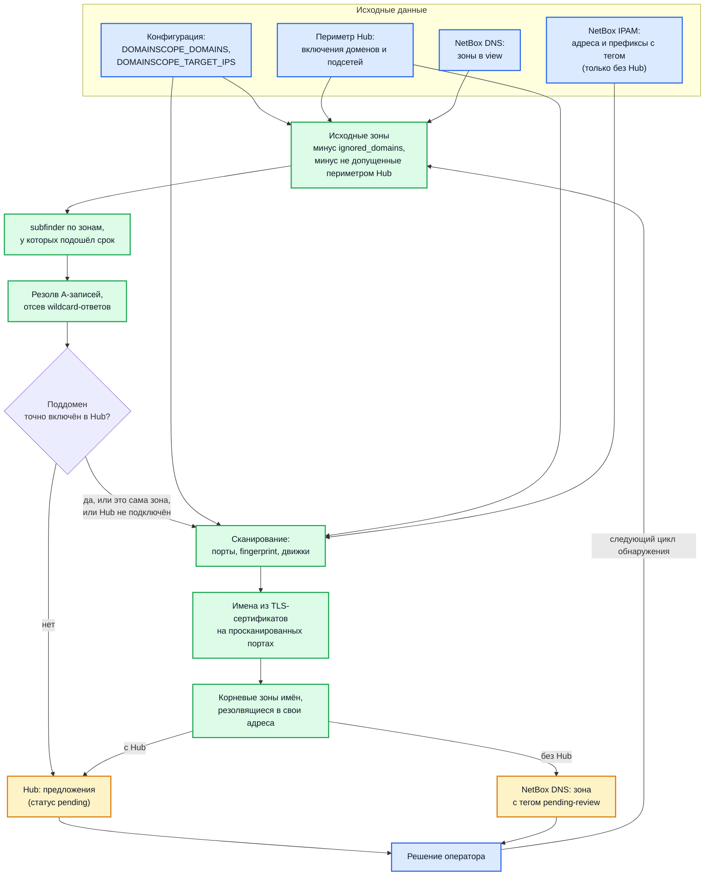

# Расширение периметра: обнаружение доменов и адресов

Как DomainScope находит новые домены, поддомены и адреса, что из найденного
сканируется сразу, а что ждёт решения оператора, и где это решение
принимается. Страница описывает механизм целиком; экраны Hub, на которых
разбираются предложения, подробно показаны в разделе
[Связка DomainScope и Hub](perimeter-integration.md#предложения-расширить-периметр),
здесь на них только ссылки.

Главное правило: **DomainScope сам периметр не расширяет.** Он перечисляет
поддомены уже известных зон, резолвит их и читает сертификаты, но новое имя
попадает в активное сканирование, только если его допустил оператор — записью
в Hub, тегом в NetBox или строкой в конфигурации.

## Два режима работы

Поведение обнаружения зависит от того, подключён ли Hub
(`DOMAINSCOPE_HUB_ENABLED=true`).

| | С Hub | Без Hub (только NetBox или конфигурация) |
| --- | --- | --- |
| Откуда исходные домены | конфигурация, включения периметра Hub, зоны NetBox DNS — **и только то, что допускает периметр Hub** | конфигурация и зоны NetBox DNS |
| Откуда адреса | конфигурация и включённые подсети Hub | конфигурация и адреса и префиксы NetBox IPAM с тегом |
| Найденный subfinder поддомен | **не сканируется**, уходит в Hub предложением, пока для него нет точной записи включения | сканируется сразу |
| Новая корневая зона из сертификата | предложение в Hub (с оговоркой, см. [ниже](#новые-корневые-зоны-из-сертификатов)) | зона в NetBox DNS с тегом `pending-review` и находка в Hub |
| Где оператор принимает решение | веб-интерфейс Hub → проект → Скоуп → «Предложения» | NetBox: снять тег или удалить зону |

Включение Hub переключает DomainScope целиком: при подключённом Hub адреса и
префиксы NetBox IPAM как цели больше не загружаются — периметр берётся из Hub.

## Поток данных

## Откуда берутся исходные домены и адреса

| Источник | Как задаётся | Что даёт | Метка происхождения |
| --- | --- | --- | --- |
| Конфигурация | `DOMAINSCOPE_DOMAINS` или `domains:` в YAML | корневые зоны для subfinder | `config` |
| Конфигурация | `DOMAINSCOPE_TARGET_IPS` или `target_ips:` в YAML | одиночные адреса для сканирования | — |
| Периметр Hub, домены | записи включения в проекте Hub | корневые зоны для subfinder | `scope_entry` |
| Периметр Hub, подсети | записи включения подсетей | адреса для сканирования | `scope_entry` |
| NetBox DNS | зоны в view `DOMAINSCOPE_NETBOX_DNS_EXPORT_VIEW` | корневые зоны для subfinder | `netbox_dns` |
| NetBox IPAM | адреса и префиксы с тегом `DOMAINSCOPE_NETBOX_TAG` в статусе `active` | адреса для сканирования — **только без Hub** | `netbox_import` |

Подробности по каждому источнику:

- **`DOMAINSCOPE_TARGET_IPS` принимает только одиночные адреса.** Значение
  вида `192.0.2.0/24` не разбирается как адрес и пропускается с
  предупреждением `invalid ip address, skipping`. Подсеть задавайте записью
  периметра Hub или префиксом в NetBox. Известное ограничение,
  исправление отслеживается в [DomainScope#8](https://gitlab.com/hub_infosec/DomainScope/-/work_items/8).
- **Периметр Hub читается дважды.** При старте — `GET /projects/<id>/scope`,
  домены из него добавляются к конфигурации. Затем в каждом цикле
  обнаружения — `GET /projects/<id>/scope/export?format=json`: включения
  доменов становятся исходными зонами, исключения и отключённые записи —
  запретами, включённые подсети разворачиваются в адреса.
- **Используется только первый проект.** В `DOMAINSCOPE_HUB_PROJECT_IDS` можно
  перечислить несколько идентификаторов, но периметр берётся и предложения
  отправляются только для первого из них. Известное ограничение,
  исправление отслеживается в [DomainScope#7](https://gitlab.com/hub_infosec/DomainScope/-/work_items/7).
- **Подсети крупнее `/20` и IPv6-подсети не разворачиваются** — ни из Hub, ни
  из NetBox. Ограничение описано в
  [Связке DomainScope и Hub](perimeter-integration.md).
- **Зоны NetBox DNS читаются, только если включён экспорт DNS**
  (`DOMAINSCOPE_NETBOX_DNS_EXPORT_ENABLED=true` и задан view). Зоны с тегом
  `ignore-scan` или `pending-review` исходными не становятся.

Перед перечислением поддоменов список исходных зон проходит два фильтра:

1. **`DOMAINSCOPE_IGNORED_DOMAINS`** — зона и всё под ней выбрасываются
   (пример из конфигурации — `reg.ru`). Те же корни сразу помечают
   игнорируемыми и найденные под ними поддомены.
2. **Периметр Hub** (только при подключённом Hub) — зона остаётся, если её
   допускает самая точная совпавшая запись периметра. Отброшенные зоны
   видны в журнале как `seed domain blocked by hub scope`.

!!! warning "С Hub исходная зона должна быть включена в периметр Hub"
    Фильтр отбрасывает не только зоны под исключением, но и зоны, для которых
    в периметре **нет ни одной подходящей записи**. Домен из
    `DOMAINSCOPE_DOMAINS` или зона NetBox DNS, не покрытые включением в Hub,
    при подключённом Hub не перечисляются и не сканируются — в журнале у них
    причина `out of scope (no matching rule)`. Пустой периметр Hub означает,
    что не сканируется ничего.

## Как DomainScope обнаруживает новое

### Поддомены: subfinder

Для каждой исходной зоны запускается встроенный subfinder — пассивное
перечисление по открытым источникам. Активного перебора имён, запроса передачи
зоны и рекурсивного обхода найденных поддоменов нет: subfinder запускается
только на исходных зонах.

| Параметр | Значение | Настраивается |
| --- | --- | --- |
| Источники | набор subfinder по умолчанию, без медленных источников | нет |
| Ключи API источников | не передаются | нет |
| Потоки и ограничение запросов | 10 потоков, 10 запросов в секунду | нет |
| Таймаут источника | 30 секунд | нет |
| Потолок перечисления одной зоны | 10 минут | нет |
| Фильтр wildcard-имён subfinder | включён | нет |

Зоны перечисляются **строго по одной**: параллельный запуск отключён из-за
гонки данных в самой библиотеке subfinder. Время уходит в основном на ожидание
источников и почти не зависит от числа находок — замер на рабочих зонах дал в
среднем 49 секунд на зону.

### Расписание перечисления зон (0.33)

Поэтому за цикл перечисляются не все зоны:

- каждая зона перечисляется **не чаще раза в 24 часа**;
- за один цикл берётся **не больше 25 зон**: сначала те, что не
  перечислялись ни разу, затем самые давние;
- у пропущенных зон известные поддомены берутся из базы и всё равно
  резолвятся заново, поэтому адреса целей не устаревают;
- расписание хранится в памяти процесса: после перезапуска все зоны
  считаются просроченными, и обход начинается заново, по 25 зон за цикл.

!!! warning "Известное ограничение: расписание не настраивается"
    Оба значения зашиты в код, переменных окружения для них нет. При 500 зонах
    полный обход занимает около 20 циклов, то есть новая зона в периметре
    перечисляется в ближайшем цикле, а новый поддомен старой зоны может
    появиться только через сутки и больше. Исправление отслеживается в
    [DomainScope#9](https://gitlab.com/hub_infosec/DomainScope/-/work_items/9).

### DNS-резолв

Каждая зона и все её поддомены резолвятся при каждом цикле.

- Сохраняются **только IPv4-адреса**. Цепочка CNAME проходится резолвером, но
  промежуточные имена не сохраняются; адреса IPv6 отбрасываются. Известное
  ограничение, исправление отслеживается в [DomainScope#5](https://gitlab.com/hub_infosec/DomainScope/-/work_items/5).
- Резолвер не использует системный кэш. Чтобы ходить в конкретный DNS-сервер,
  задайте `SCANNER_DNS_SERVER` (`host[:port]`, порт по умолчанию 53).
- Имя, которое не резолвится, просто пропускается. Если перестал резолвиться
  домен из периметра Hub, который раньше резолвился, DomainScope сообщает об
  этом в Hub — см.
  [Домены, переставшие резолвиться](perimeter-integration.md#домены-переставшие-резолвиться).

### Wildcard DNS

Если у зоны есть запись `*.zone` или резолвер на пути отвечает адресом на
любое несуществующее имя, каждый перечисленный кандидат «резолвится» в один и
тот же адрес. Чтобы не сканировать его десятки раз:

1. для каждой зоны резолвятся 8 случайных заведомо несуществующих имён;
2. адреса, полученные на них, считаются wildcard-ответами зоны (в журнале —
   `wildcard DNS detected for zone`);
3. поддомен, все адреса которого входят в этот набор, отбрасывается; сама
   зона не отбрасывается никогда.

Поддомен, у которого хотя бы один адрес вне wildcard-набора, считается
настоящим.

### Имена из TLS-сертификатов

Во время сканирования портов DomainScope определяет протокол на каждом
открытом порту. Если сервис работает по TLS, он устанавливает соединение
(SNI — первый домен, ведущий на этот адрес) и читает DNS-имена из поля
альтернативных имён сертификата.

Имя сохраняется в базу с меткой `tls_san`, если выполняется одно из условий:

- оно совпадает с исходной зоной или лежит под ней — под зонами из
  конфигурации, Hub и NetBox DNS, без учёта зон, найденных через сертификаты;
- оно резолвится в один из адресов, которые DomainScope уже сканировал.

Внутренние имена (`*.local`, `*.internal`, `*.cluster.local`, `*.default`,
`localhost` и подобные) не сохраняются никогда. Сохранённые имена
используются как имена хостов при сканировании и попадают в инвентарь Hub, но
отдельным предложением не отправляются.

### Новые корневые зоны из сертификатов

В начале каждого цикла обнаружения DomainScope берёт все домены своей базы,
вычисляет для каждого корневую зону (домен второго уровня с учётом публичных
суффиксов, например `example.co.uk`) и отбирает зоны, которых нет среди
исходных. Кандидат принимается, только если:

1. в конфигурации или периметре заданы собственные адреса — `DOMAINSCOPE_TARGET_IPS`,
   включённые подсети Hub или адреса NetBox IPAM. Без них этап пропускается
   целиком (`san zone expansion skipped: no own IPs configured`);
2. корневая зона резолвится хотя бы в один из этих адресов;
3. при подключённом Hub — периметр Hub её допускает.

Принятые кандидаты становятся предложениями — как именно, зависит от режима,
см. [Как DomainScope предлагает расширение](#как-domainscope-предлагает-расширение).

!!! warning "Известное ограничение: с Hub предложения корневых зон практически не создаются"
    Условие 3 проверяет кандидата тем же сопоставлением, что и исходные зоны:
    зона без подходящей записи периметра не допускается. Новая корневая зона
    по определению не покрыта включением — иначе она уже была бы исходной, —
    поэтому при подключённом Hub такой кандидат отсекается до отправки.
    Предложения из Hub-режима на практике — это поддомены, найденные
    subfinder. Новую корневую зону, замеченную в сертификатах, ищите в
    инвентаре Hub и добавляйте вручную. Исправление отслеживается в
    [DomainScope#4](https://gitlab.com/hub_infosec/DomainScope/-/work_items/4).

### Чего DomainScope не делает

- не читает журналы прозрачности сертификатов (crt.sh и подобные) напрямую —
  только в той мере, в какой их опрашивает subfinder;
- не делает обратный резолв адресов (PTR) и не расширяет периметр по ASN или
  владельцу сети — данные о владельце адреса (ip-api.com) используются только
  для обогащения находок;
- не сохраняет адреса IPv6 и не разворачивает IPv6-подсети;
- не предлагает новые адреса: все предложения от DomainScope — доменные,
  адреса в периметр добавляет только оператор.

## Что сканируется сразу, а что ждёт решения

| Что найдено | С Hub | Без Hub |
| --- | --- | --- |
| Исходная зона, допущенная периметром | резолвится и сканируется | резолвится и сканируется |
| Поддомен с точной записью включения в Hub | сканируется | — |
| Поддомен без точной записи включения (даже под включённым родителем) | не сканируется, отправляется предложением | сканируется |
| Поддомен под исключением Hub | не сканируется, предложения нет | — |
| Поддомен с тегом `ignore-scan` в NetBox DNS (на записи, зоне или родителе) | не сканируется, предложения нет | не сканируется |
| Поддомен под `DOMAINSCOPE_IGNORED_DOMAINS` | не сканируется | не сканируется |
| Поддомен-«призрак» wildcard-зоны | отбрасывается | отбрасывается |
| Имя из сертификата | сохраняется, отдельного предложения нет | сохраняется |
| Новая корневая зона из сертификата | см. оговорку выше | зона `pending-review` в NetBox, не сканируется до решения |

Адрес поддомена, ушедшего в предложение, тоже не сканируется — если только на
него не ведёт другой, уже допущенный домен.

!!! note "Это правило действует и на адреса из включённых подсетей"
    Адрес пропускается, когда все домены, ведущие на него, игнорируются или
    ждут решения, — даже если сам адрес входит во включённую подсеть Hub или
    задан в `DOMAINSCOPE_TARGET_IPS`. Адрес, на который не ведёт ни один
    известный домен, сканируется как обычно.

Последний фильтр перед сканированием портов действует на уровне адресов:
`DOMAINSCOPE_SARIF_IP_SCOPE` (публичные, приватные или все), тег `ignore-scan`
на адресе в NetBox IPAM, исключённые подсети Hub и, если задан
`DOMAINSCOPE_TRUSTED_IP_TAGS`, принадлежность адреса к «своим» адресам и
префиксам NetBox. Подробнее — в
[Управлении сканерами](domainscope-scanners.md).

### Статусы

Статусов три набора, и они живут в разных местах:

| Где | Статус | Значение |
| --- | --- | --- |
| База DomainScope, домены | `active` | домен участвует в обнаружении и сканировании |
| | `blocked` | домен попал под исключение периметра Hub (причина `out of scope (hub exclude)`); снимается автоматически, когда исключение убирают |
| База DomainScope, корневые зоны из сертификатов (без Hub) | `pending` | зона создана в NetBox с тегом `pending-review`, ждёт решения |
| | `approved` | оператор снял тег |
| | `ignored` | оператор удалил зону |
| Hub, предложения | `pending` | ждёт решения |
| | `approved` | одобрено — создана запись включения или исключения |
| | `rejected` | отклонено |

## Как DomainScope предлагает расширение

### С Hub

В каждом цикле обнаружения, после резолва, DomainScope отправляет в
`POST /projects/<id>/scope/proposals` все поддомены, которые не получили
точной записи включения, — порциями по 100. В предложении передаются имя,
сканер (`domainscope`), исходная зона и первый адрес, в который имя
резолвится. Формат запроса — в
[справочнике эндпоинтов](perimeter-integration.md#post-projectsscopeproposals).

Как Hub обрабатывает приходящие предложения:

- **уже есть своя активная запись** с тем же значением — предложение не
  создаётся. Включение родителя этому не мешает: поддомен под включённой
  зоной всё равно предлагается отдельной строкой;
- **предложение уже ждёт решения** — не меняется, правка значения
  оператором не затирается;
- **предложение уже отклонено** — возвращается в ожидание. Сканер присылает
  те же имена каждый цикл, поэтому отклонённое всплывает снова на ближайшем
  цикле обнаружения.

Кроме DomainScope, предложения создаёт сама Hub-синхронизация с NetBox
(сканер `netbox-sync`). Это предложения **на сужение**, с пометкой
«Предлагается исключить»: домен, все адреса которого NetBox IPAM держит в
неактивном статусе, предлагается исключить из периметра. Предложение
появляется, только если освобождены все известные адреса домена, и не больше
200 за прогон синхронизации.

### Без Hub: NetBox и тег `pending-review`

Работает, если включены NetBox и экспорт DNS
(`DOMAINSCOPE_NETBOX_DNS_EXPORT_ENABLED=true`, задан view). Для каждой новой
корневой зоны из сертификатов DomainScope:

1. создаёт зону в NetBox DNS с тегом `DOMAINSCOPE_NETBOX_PENDING_REVIEW_TAG`
   (по умолчанию `pending-review`); если создать не удалось — повторит на
   следующем цикле;
2. записывает зону в свою базу со статусом `pending`;
3. при заданном продукте SARIF отправляет в Hub находку уровня `warning` с
   правилом `tls-san-new-domain` — чтобы новая зона была видна в списке
   находок, а не только в журнале.

Зоны с тегом `pending-review` исходными не становятся. В начале каждого
следующего цикла DomainScope проверяет ожидающие зоны в NetBox:

| Что сделал оператор в NetBox | Статус | Что дальше |
| --- | --- | --- |
| снял тег с зоны | `approved` | зона станет исходной со следующего цикла |
| удалил зону | `ignored` | больше не предлагается |
| ничего | `pending` | ждёт |

Решение вступает в силу не сразу: список исходных зон собирается до этой
проверки, поэтому одобренная зона перечисляется **через цикл** после снятия
тега.

### Обратная запись адресов в NetBox IPAM

Если NetBox подключён (`DOMAINSCOPE_NETBOX_ENABLED=true`), в конце каждого
цикла обнаружения DomainScope записывает в NetBox IPAM публичные адреса этого
цикла: адреса из периметра Hub или NetBox и адреса допущенных к сканированию
доменов. Новые адреса создаются в статусе `active` с двумя тегами —
`DOMAINSCOPE_NETBOX_TAG` и `DOMAINSCOPE_NETBOX_CRAWLER_TAG`; адрес в другом
статусе возвращается в `active`.

!!! warning "Обратная запись — тоже расширение периметра"
    Созданный адрес получает основной тег `DOMAINSCOPE_NETBOX_TAG` — тот же,
    по которому DomainScope без Hub выбирает цели. Значит, в режиме без Hub
    адрес, однажды разрезолвленный, становится постоянной целью уже на
    следующем цикле, без отдельного решения. В статус `deprecated` DomainScope
    сам ничего не переводит. Пустой `DOMAINSCOPE_NETBOX_CRAWLER_TAG` убирает
    только второй тег, но не саму запись. Известное ограничение, исправление
    отслеживается в [DomainScope#10](https://gitlab.com/hub_infosec/DomainScope/-/work_items/10).

## Как оператору принять или отклонить предложение

Предложения разбираются в веб-интерфейсе Hub: проект → Скоуп → «Предложения».
Для каждого предложения есть три решения — одобрить и включить, одобрить и
исключить, отклонить; перед одобрением значение можно поправить, а вместе с
доменом — отметить адреса, в которые он резолвится (и наоборот). Экраны и
смысл решений описаны в разделе
[Предложения расширить периметр](perimeter-integration.md#предложения-расширить-периметр).

Коротко о последствиях:

- **одобрить и включить** — появляется запись включения с источником
  `approved_proposal`; со следующего цикла обнаружения домен сканируется и
  сам становится исходной зоной для subfinder;
- **одобрить и исключить** — появляется исключение; открытые находки по
  исключённым хостам закрываются, DomainScope больше этот домен не предлагает;
- **отклонить** — ничего не создаётся, и на следующем цикле предложение
  вернётся. Чтобы домен перестал всплывать, его нужно исключить, а не
  отклонять.

Те же действия доступны через API: `PUT /projects/<id>/scope/proposals/<proposal_id>`
и `POST /projects/<id>/scope/proposals/batch-review` (до 200 предложений за
запрос). Решение требует права на запись в проект, для сервисной учётной
записи — право `manage_scope`; создание предложений — `upload_report`.
Подробнее — [REST API](api.md). Решение записывается в журнал аудита.

## Как оператору расширить периметр вручную

**С Hub** — всё через периметр проекта, конфигурацию воркера менять не нужно:

- новая корневая зона или подсеть — запись включения
  ([вручную, CSV или синхронизацией с NetBox](perimeter-integration.md#шаг-2-в-веб-интерфейсе-периметр-сканирования));
- конкретный поддомен — дождаться предложения и одобрить его, либо сразу
  добавить точную запись включения. Включения родителя недостаточно,
  чтобы поддомен, найденный subfinder, начал сканироваться;
- изменения подхватываются на следующем цикле обнаружения; чтобы ускорить —
  перезапустить воркер.

**Без Hub:**

- домены — `DOMAINSCOPE_DOMAINS` или зона в NetBox DNS (в view экспорта, без
  тегов `ignore-scan` и `pending-review`);
- адреса — `DOMAINSCOPE_TARGET_IPS` (одиночные адреса) или адрес либо
  префикс NetBox IPAM с тегом `DOMAINSCOPE_NETBOX_TAG` в статусе `active`;
- изменение конфигурации требует перезапуска, изменения в NetBox — нет.

**Сузить периметр** можно на любом уровне: исключением в Hub, тегом
`ignore-scan` на зоне, записи или адресе в NetBox, корнем в
`DOMAINSCOPE_IGNORED_DOMAINS`. Тег `ignore-scan` на записи наследуется её
поддоменами.

## Происхождение

Для каждого домена и адреса DomainScope хранит, откуда он взялся (`config`,
`scope_entry`, `netbox_dns`, `subfinder`, `tls_san` для доменов и
`netbox_import`, `dns_resolve`, `scope_entry` для адресов), и строит из этого
цепочку обнаружения, которая уходит в Hub вместе с находкой. Источники
перечислены на странице [Происхождение записей периметра](domainscope-trails.md).

!!! warning "Известное ограничение: домены Hub, полученные при старте, помечаются как `config`"
    Домены из периметра Hub, прочитанные при запуске воркера, добавляются к
    списку из конфигурации. В цепочке происхождения они поэтому получают
    метку `config`, а не `scope_entry`. Метку `scope_entry` получают домены,
    добавленные в периметр Hub после запуска. Исправление отслеживается в
    [DomainScope#6](https://gitlab.com/hub_infosec/DomainScope/-/work_items/6).

## Интервалы и настройки, влияющие на обнаружение

| Настройка | По умолчанию | Влияние |
| --- | --- | --- |
| `DOMAINSCOPE_TIME_LOOP_DISCOVERY` | `21600` (6 ч) | период цикла обнаружения: чтение периметра, subfinder, резолв, отправка предложений и инвентаря |
| `DOMAINSCOPE_TIME_LOOP_PORTSCAN` | `7200` (2 ч) | период сканирования портов — именно в нём читаются сертификаты и находятся имена `tls_san` |
| Расписание зон | 24 ч на зону, 25 зон за цикл | не настраивается |
| `DOMAINSCOPE_IGNORED_DOMAINS` | пусто | корни, исключаемые из обнаружения вместе с поддоменами |
| `DOMAINSCOPE_NETBOX_IGNORE_SCAN_TAG` | `ignore-scan` | тег исключения в NetBox DNS и IPAM |
| `DOMAINSCOPE_NETBOX_PENDING_REVIEW_TAG` | `pending-review` | тег зон, ожидающих решения (без Hub) |
| `DOMAINSCOPE_NETBOX_TAG` | `public-ip` | тег целей в NetBox IPAM и основной тег при обратной записи |
| `DOMAINSCOPE_NETBOX_CRAWLER_TAG` | `domainscope-crawler` | дополнительный тег при обратной записи |
| `DOMAINSCOPE_TRUSTED_IP_TAGS` | пусто | ограничивает сканирование портов «своими» адресами NetBox |
| `SCANNER_DNS_SERVER` | пусто | DNS-сервер для резолва |
| `DOMAINSCOPE_SCOPE_FAIL_OPEN` | `false` | что делать активным сканерам, если периметр Hub недоступен |

Полный список — в [Переменных окружения DomainScope](env-domainscope.md).

Если Hub недоступен, а копии периметра нет или она старше часа, фильтр
периметра в этом цикле не применяется: обнаружение продолжается, а активное
сканирование пропускается, пока не задан `DOMAINSCOPE_SCOPE_FAIL_OPEN=true`.

## Ограничения и подводные камни

- **Подключённый Hub сужает исходный список.** Домены из конфигурации и зоны
  NetBox DNS без подходящего включения в Hub перестают сканироваться — это
  частая причина «после подключения Hub всё пропало».
- **Новые корневые зоны из сертификатов с Hub не предлагаются** (см.
  [оговорку](#новые-корневые-зоны-из-сертификатов)). Новые зоны компании
  приходится добавлять вручную.
- **Поддомены появляются с задержкой.** Зона перечисляется раз в сутки, по
  25 зон за цикл; после перезапуска обход начинается заново.
- **Пассивные источники неполны.** subfinder работает без ключей API, только с
  быстрыми источниками. Имена, которых нет в открытых источниках (внутренние,
  свежие, не светившиеся в сертификатах), не находятся.
- **Только IPv4.** Хосты, доступные только по IPv6, не сканируются.
- **CDN и общий хостинг.** Поддомен, указывающий через CNAME на CDN,
  резолвится в адреса CDN. Если такой поддомен одобрить, сканироваться будут
  чужие адреса. При одобрении вместе с адресами не отмечайте адреса CDN;
  ограничить сканирование «своими» адресами позволяет
  `DOMAINSCOPE_TRUSTED_IP_TAGS`. Сертификаты общего хостинга содержат десятки
  чужих имён — их отсекает проверка принадлежности, но имя, резолвящееся в
  тот же общий адрес, проверку проходит.
- **Wildcard-фильтр не защищает от неполного пула.** Если wildcard-ответ —
  большой пул адресов, восьми проб может не хватить, чтобы увидеть их все, и
  часть «призраков» пройдёт как настоящие поддомены.
- **Отклонение — не решение «никогда».** Отклонённое предложение вернётся на
  следующем цикле. Барьер — это исключение.
- **Без Hub обратная запись в NetBox расширяет цели сама** — см.
  [предупреждение](#обратная-запись-адресов-в-netbox-ipam).

## Связанные документы

- [Связка DomainScope и Hub](perimeter-integration.md) — периметр, предложения, инвентарь, отчёт о резолве
- [Обзор DomainScope](domainscope-overview.md)
- [Управление сканерами DomainScope](domainscope-scanners.md)
- [Синхронизация с NetBox](domainscope-netbox.md)
- [Происхождение записей периметра](domainscope-trails.md)
- [Синхронизация периметра с NetBox](integration-netbox.md) — синхронизация со стороны Hub
- [Переменные окружения DomainScope](env-domainscope.md)
