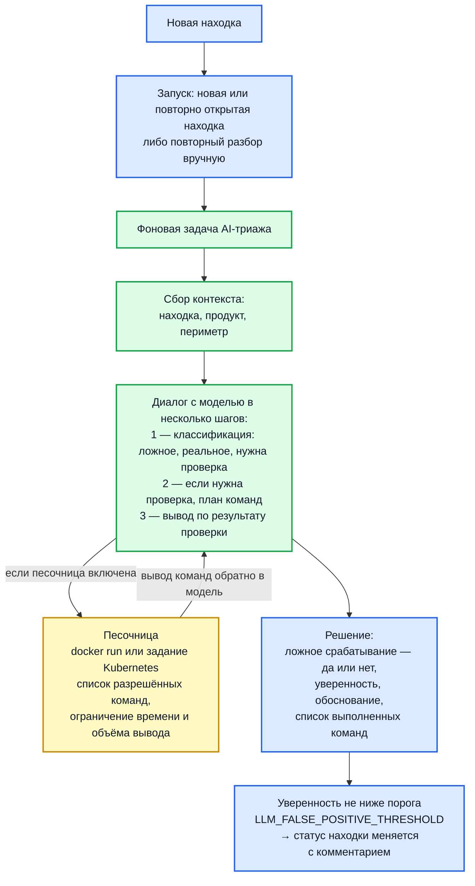

# AI-триаж и песочница

Hub использует LLM для триажа находки: оценить, является ли находка false-positive, предложить план верификации, опционально выполнить активную проверку через sandbox (запустить `nmap`/`curl`/`nuclei` против цели).

## Архитектура



## Переменные окружения

### LLM

| Переменная                     | Default       | Описание                                                    |
| ------------------------------ | ------------- | ----------------------------------------------------------- |
| `LLM_BASE_URL`                 | —             | Базовый URL OpenAI-compatible API                           |
| `LLM_API_KEY`                  | —             | API-ключ                                                    |
| `LLM_MODEL`                    | `glm-4-plus`  | Модель (рекомендация для prod: `glm-4-plus` или эквивалент) |
| `LLM_DRY_RUN`                  | `false`       | Запросы к модели выполняются, но результат в базу не пишется |
| `LLM_FALSE_POSITIVE_THRESHOLD` | `0.9`         | Порог confidence для автоматической смены статуса           |
| `LLM_CONFIRM_BEFORE_DISMISS`   | `true`        | Перед автоматической отбраковкой без песочницы — повторный запрос; при расхождении находка остаётся человеку |
| `LLM_WORKERS`                  | `5`           | **0 в backend, > 0 только в worker-pod**                    |
| `LLM_REQUEST_TIMEOUT_SECONDS`  | `180`         | Timeout на один LLM-запрос                                  |
| `LLM_PROMPTS_DIR`              | —             | Каталог с собственными файлами промптов вместо встроенных   |
| `LLM_SECRET`                   | значение `LICENSE_SECRET` | Ключ шифрования API-ключа, сохранённого через интерфейс. У backend и worker обязан совпадать |

Анализ включается, только если в процессе заданы и `LLM_BASE_URL`, и
`LLM_API_KEY`: без них backend не ставит задачи в очередь, а worker их не
выполняет. Обе переменные нужны **и backend, и worker** с одинаковыми
значениями. Если они заданы только у backend, задачи ставятся, но никто их не
берёт — они остаются в состоянии Available (см.
[Диагностика](troubleshooting.md#ai-available)).

Поставляемые чарт и `docker-compose.yml` задают LLM в одном месте и передают
значения обоим процессам — см. [Включение](#включение-llm-без-sandbox).
`LLM_WORKERS` они расставляют сами: `0` у backend (он только ставит задачи в
очередь), заданное число — у worker.

Модель, порог, таймаут, число исполнителей, режим без записи и системный
промпт можно задать и в административном разделе (страница «Настройки LLM»,
`GET`/`PUT /api/v1/admin/llm-settings`). Переменная окружения, заданная
явно, имеет приоритет над настройкой из интерфейса.

!!! warning "Адрес и ключ из интерфейса в текущей версии не применяются"

    На странице «Настройки LLM» можно сохранить адрес API и ключ, и страница
    покажет их источником настройки установки. Но к выполнению задач в
    текущей версии они не применяются: ставит и выполняет задачи только
    процесс, у которого `LLM_BASE_URL` и `LLM_API_KEY` заданы в окружении.
    Задавайте адрес и ключ в values чарта или в `.env`.

> **КРИТИЧНО:** Если собираете окружение сами, в backend задавайте `LLM_WORKERS=0` — backend только ставит задачи в очередь. В worker (компонент `worker`) — `LLM_WORKERS=N` (типично 1-5).

### Sandbox

| Переменная                | Default                           | Описание                            |
| ------------------------- | --------------------------------- | ----------------------------------- |
| `SANDBOX_TYPE`            | `""` (выключен)                   | `""` / `docker` / `kubernetes`      |
| `SANDBOX_IMAGE`           | `dexionius/sshub-sandbox-tools:latest` | Образ с инструментами          |
| `SANDBOX_TIMEOUT_SECONDS` | `120`                             | Предел на запуск песочницы целиком; каждой команде — на 10 с меньше, но не меньше 10 с |
| `SANDBOX_OUTPUT_LIMIT_KB` | `10`                              | Лимит stdout+stderr                 |
| `SANDBOX_NAMESPACE`       | —                                 | K8s namespace (только `kubernetes`) |
| `SANDBOX_KUBECONFIG`      | —                                 | Путь к файлу kubeconfig; пусто — учётные данные пода (in-cluster) |
| `SANDBOX_WG_*`            | —                                 | Выход к цели через WireGuard: `SANDBOX_WG_PRIVATE_KEY`, `SANDBOX_WG_SERVER_PUBLIC_KEY`, `SANDBOX_WG_SERVER_ENDPOINT`, `SANDBOX_WG_POD_IP` (по умолчанию `10.200.0.3/32`) в docker-режиме, `SANDBOX_WG_SECRET_NAME` — в kubernetes |

## Требования к языковой модели

Hub обращается к сервису, совместимому по API с интерфейсом дополнения чата
в стиле OpenAI. Подойдёт как облачный сервис, так и модель, развёрнутая у вас
— перечня провайдеров, совместимость с которыми подтверждена испытаниями, мы
не приводим.

Задаются три параметра:

| Переменная | Что указать |
| --- | --- |
| `LLM_BASE_URL` | Базовый адрес API. В промышленной среде обязан быть `https` — иначе запуск прервётся, поскольку ключ передаётся в каждом запросе |
| `LLM_API_KEY` | Ключ доступа |
| `LLM_MODEL` | Имя модели в терминах выбранного сервиса |

Выбирая модель, учитывайте: разбор выполняется по каждой новой находке, и на
крупном потоке это заметный объём обращений. Начинать разумно с недорогой
модели и ограниченного набора проектов, а `LLM_WORKERS` держать небольшим,
пока не станет понятен фактический расход.

!!! warning "Что уходит наружу"

    В запрос попадают сведения о находке: правило, местоположение, описание, а
    для находок в коде — фрагмент исходника. Если сервис внешний, это
    передача данных за периметр. Решите этот вопрос до включения возможности —
    и рассмотрите вариант с моделью, развёрнутой внутри контура.

## Включение LLM (без sandbox)

Самый безопасный первый шаг — только классификация без активной проверки.
Адрес, ключ и параметры модели задаются один раз — для backend и worker
сразу.

### Helm

Блок `llm:` чарта `security-scan-hub`; в umbrella-чарте `hub-platform` тот же
блок вложен в `hub:`.

```yaml
# umbrella hub-platform: values.yaml
hub:
  llm:
    enabled: true
    baseUrl: https://open.bigmodel.cn/api/paas/v4/
    model: glm-4-flash
    workers: 3                      # исполнителей в worker; backend всегда 0
    falsePositiveThreshold: "0.9"
    dryRun: false
  worker:
    worker:
      env:
        sandboxType: ""             # пусто = песочница выключена

# ключ — в отдельном файле, который не хранится в git (secrets.yaml)
secrets:
  hubLlmApiKey: <secret>
```

При установке одного чарта `security-scan-hub` блок пишется без `hub:`, а
ключ — в `llm.apiKey`. Если ключ уже лежит в своём Secret, укажите его вместо
значения:

```yaml
llm:
  enabled: true
  baseUrl: https://open.bigmodel.cn/api/paas/v4/
  existingSecret: hub-llm           # Secret в namespace релиза
  existingSecretKey: llm-api-key
```

| Ключ `llm.*` | Переменная | По умолчанию |
| --- | --- | --- |
| `enabled` | — | `false` |
| `baseUrl` | `LLM_BASE_URL` | — |
| `apiKey` / `existingSecret` + `existingSecretKey` | `LLM_API_KEY` | — / `llm-api-key` |
| `model` | `LLM_MODEL` | `glm-4-plus`; пусто — переменная не передаётся |
| `dryRun` | `LLM_DRY_RUN` | `false` |
| `falsePositiveThreshold` | `LLM_FALSE_POSITIVE_THRESHOLD` | `0.9` |
| `requestTimeoutSeconds` | `LLM_REQUEST_TIMEOUT_SECONDS` | `180` |
| `workers` | `LLM_WORKERS` у worker (у backend всегда `0`) | `3` |
| `promptsDir` | `LLM_PROMPTS_DIR` | — |

Чарт проверяет настройку при `helm install`/`upgrade` и останавливается с
понятной ошибкой, если при `enabled: true` пуст `baseUrl`, нет ни `apiKey`,
ни `existingSecret`, `workers` меньше 1 или адрес начинается с `http://` при
`appEnv: production`. Ключ подключается без `optional`: если Secret или ключа
в нём нет, под не стартует (`CreateContainerConfigError` с именем Secret), а
не работает молча без ключа. Ключ из `llm.apiKey` хранится в Secret чарта
(`llmApiKey`) и переживает `helm upgrade`. При смене настроек поды backend и
worker перезапускаются сами (аннотация `checksum/llm`); исключение — смена
значения внутри внешнего Secret из `existingSecret`: после неё выполните
`kubectl rollout restart` для backend и worker.

После установки раздел `== AI-триаж ==` в выводе `helm install`/`upgrade`
показывает итоговые адрес, модель, число исполнителей, источник ключа и
команду проверки. Прежние ключи `backend.backend.env.llm*` и
`worker.worker.env.llm*` пока читаются, но устарели — см.
[Обновления](upgrades.md#llm-values).

### Docker Compose

Переменные `LLM_*` задаются в `.env`; `docker-compose.yml` передаёт их и
backend, и worker, а `LLM_WORKERS` расставляет сам (`0` у backend).

```ini
# .env
LLM_BASE_URL=https://open.bigmodel.cn/api/paas/v4/
LLM_API_KEY=<secret>
LLM_MODEL=glm-4-flash
LLM_WORKERS=3
LLM_FALSE_POSITIVE_THRESHOLD=0.9
SANDBOX_TYPE=    # пусто = выключен
```

```bash
docker compose up -d backend worker   # restart не перечитывает .env
```

### Своё окружение

Если запускаете процессы сами, задайте одинаковые значения обоим:

```ini
# backend
LLM_BASE_URL=https://open.bigmodel.cn/api/paas/v4/
LLM_API_KEY=<secret>
LLM_WORKERS=0

# worker
LLM_BASE_URL=https://open.bigmodel.cn/api/paas/v4/
LLM_API_KEY=<secret>
LLM_MODEL=glm-4-flash
LLM_WORKERS=3
LLM_FALSE_POSITIVE_THRESHOLD=0.9
SANDBOX_TYPE=    # пусто = выключен
```

### Проверка

Worker, подписавшийся на очередь, пишет при старте строку
`LLM analysis worker registered`:

```bash
kubectl -n hub logs deploy/hub-worker | grep "LLM analysis"
docker compose logs worker | grep "LLM analysis"
```

Пустой вывод значит, что worker на очередь не подписан и задачи будут висеть
в Available — см. [Диагностика](troubleshooting.md#ai-available).

После рестарта worker:

- Worker начнёт триажить новые и повторно открытые находки (в проекте, где AI-триаж не выключен)
- В UI Hub в карточке находки появится секция `LLM Analysis` с reasoning и confidence
- При вердикте `false_positive`, `confirmed`, `risk_accepted` или `wont_fix` и `confidence ≥ threshold` статус находки меняется автоматически. Для секретов порог отбраковки не ниже встроенного минимума. Статус, выставленный человеком, AI не меняет

## Включение Sandbox (активная верификация)

Sandbox запускает команды (nmap/curl/nuclei) против цели находки. Используется когда нужна реальная проверка — например, "точно ли порт 22 открыт".

### Docker-режим (dev / single-host)

```ini
SANDBOX_TYPE=docker
SANDBOX_IMAGE=<registry>/sandbox-tools:latest
SANDBOX_TIMEOUT_SECONDS=120
SANDBOX_OUTPUT_LIMIT_KB=10
```

Требования:

- Worker должен иметь доступ к Docker daemon (mount `/var/run/docker.sock` или `DOCKER_HOST`). В поставляемом `docker-compose.yml` монтирование сокета и `group_add` у worker'а заготовлены закомментированными — раскомментируйте их и задайте в `.env` `SANDBOX_TYPE=docker`. Доступ к сокету равнозначен правам root на хосте
- Образ должен быть доступен (приватный registry — `docker login`)

### Kubernetes-режим (production)

```ini
SANDBOX_TYPE=kubernetes
SANDBOX_IMAGE=registry.example.com/sandbox-tools:1.0
SANDBOX_TIMEOUT_SECONDS=180
SANDBOX_OUTPUT_LIMIT_KB=20
SANDBOX_NAMESPACE=hub-sandbox
# SANDBOX_KUBECONFIG не задан — используются учётные данные пода
```

Hub создаёт `Job` в указанном namespace и удаляет его после чтения вывода.
Чарт выдаёт worker права на `jobs`, `pods` и `pods/log` в namespace релиза;
если песочница работает в другом namespace, выдайте эти права там.
NetworkPolicy для ограничения исходящего трафика песочницы ни Hub, ни чарт не
создают.

### Allowlist команд

Hub пропускает в песочницу только команды из списка разрешённых инструментов:

- `nmap` — порт-сканирование
- `curl` — HTTP запросы
- `nc` (netcat) — TCP-проверка
- `openssl` — TLS-проверка
- `dig` — DNS-запросы
- `wget` — скачивание
- `nuclei` — vulnerability templates
- `traceroute` — трассировка
- `ping` — ICMP

**Python намеренно исключён** — слишком широкая поверхность атак.

LLM формирует команду из allowlist. Для каждого инструмента дополнительно
разрешён только определённый набор флагов, а цель команды обязана совпадать
с целью находки. Команда, не прошедшая проверку, не выполняется; остальные
команды плана выполняются, а модели сообщается, что отклонённая не
запускалась.

### Изоляция

В docker-режиме:

- Сеть `bridge`, без host-network; при настроенном WireGuard — `none` и выход только через туннель. Без WireGuard у контейнера неограниченный исходящий доступ — это режим для разработки
- Read-only root filesystem
- `no-new-privileges`, сброс всех capabilities, кроме `NET_RAW` (и `NET_ADMIN` при WireGuard)
- Лимиты: 0,5 CPU, 256 МБ памяти
- Без mount-ов хост-системы

В k8s-режиме:

- Отдельный namespace; ограничение исходящего трафика — NetworkPolicy, которую готовите вы
- `readOnlyRootFilesystem: true`, `allowPrivilegeEscalation: false`, сброс всех capabilities, кроме `NET_RAW` (и `NET_ADMIN` при WireGuard)
- Лимиты: 500m CPU, 256Mi памяти; `activeDeadlineSeconds` равен `SANDBOX_TIMEOUT_SECONDS`

## Безопасность

### Что НЕЛЬЗЯ делать

- ❌ Запускать sandbox без изоляции (без `SANDBOX_TYPE` лучше, чем плохой `SANDBOX_TYPE=host`)
- ❌ Дать LLM возможность выполнять произвольный shell — только allowlist
- ❌ Слать в LLM содержимое HTTP responses без редактирования (могут попасть PII / credentials из тела)
- ❌ Включать LLM-триаж в `LLM_WORKERS > 0` сразу в backend — это распылит активность и сломает изоляцию очередей

### Что обязательно

- ✅ Регулярно проверять `SANDBOX_OUTPUT_LIMIT_KB` (защита от prompt-injection через большой output)
- ✅ Использовать отдельный API-key для LLM-провайдера, ротировать раз в квартал
- ✅ Мониторить расходы (LLM-провайдеры могут стоить дорого при росте числа находок)
- ✅ Sandbox-образ — приватный registry, тегированный по SHA (не `:latest`)

## Стоимость

Грубая оценка для 1000 находок в день:

- Многошаговый диалог: примерно 10 тыс. входных и 2 тыс. выходных токенов на одну находку
- Sandbox: добавляет ещё ~5k tokens (для парсинга stdout)

При $1.5/1M output tokens (glm-4-plus) и 1000 находок:

- Без sandbox: ~$3-5/день
- С sandbox: ~$8-12/день

Подключите budget alerts у провайдера.

## Режим без отправки

Для оценки качества LLM без изменения находок:

```ini
LLM_DRY_RUN=true
```

Запросы к модели выполняются и квоту расходуют, вердикт и уверенность пишутся в журнал, но ни статус, ни данные находки не меняются. Полезно для калибровки `LLM_FALSE_POSITIVE_THRESHOLD`.

## Мониторинг

- Очередь `llm_analysis` — глубина
- Failed jobs — ошибки от провайдера

### Метрики (если включены)

- `securityhub_llm_tokens_total{model,kind}` — расход токенов, `kind`: `prompt`, `completion`, `cached`
- `securityhub_llm_dismissal_blocked_total{verdict,reason}` — отбраковки, отменённые повторным запросом (`LLM_CONFIRM_BEFORE_DISMISS`)
- `securityhub_river_jobs{kind="llm_analysis",state}` — задачи AI-триажа по состояниям

### Логи

```bash
docker compose logs -f worker | grep llm
docker compose logs -f worker | grep sandbox
```

## Типовые проблемы

| Симптом                           | Что проверить                                                                              |
| --------------------------------- | ------------------------------------------------------------------------------------------ |
| Задачи висят в Available          | У worker'а нет `LLM_BASE_URL`, `LLM_API_KEY` или `LLM_WORKERS>0` — см. [Диагностика](troubleshooting.md#ai-available) |
| `429 Too Many Requests`           | Превышен rate limit провайдера. Уменьшите `LLM_WORKERS` или включите задержку в провайдере |
| `Sandbox failed: image not found` | Образ недоступен. Проверьте `docker pull $SANDBOX_IMAGE` или `kubectl get pods`            |
| Sandbox команды timeout           | Увеличьте `SANDBOX_TIMEOUT_SECONDS`                                                        |
| False-positive mass-marked        | Повысьте threshold (например, до `0.95`) или временно включите `LLM_DRY_RUN=true` для аудита |
